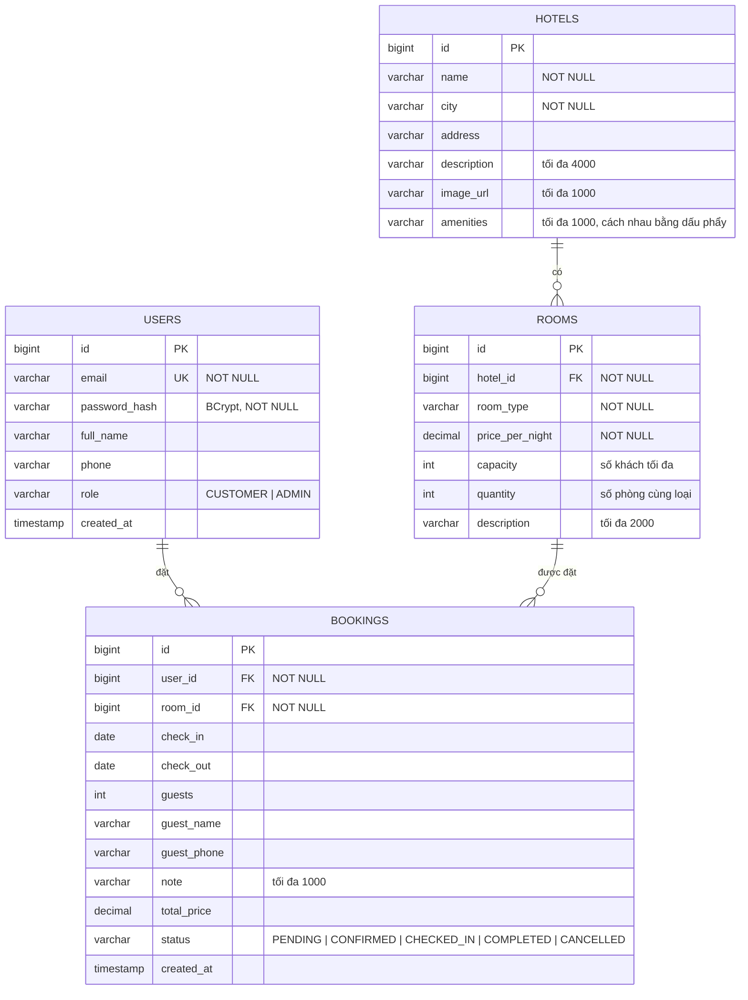
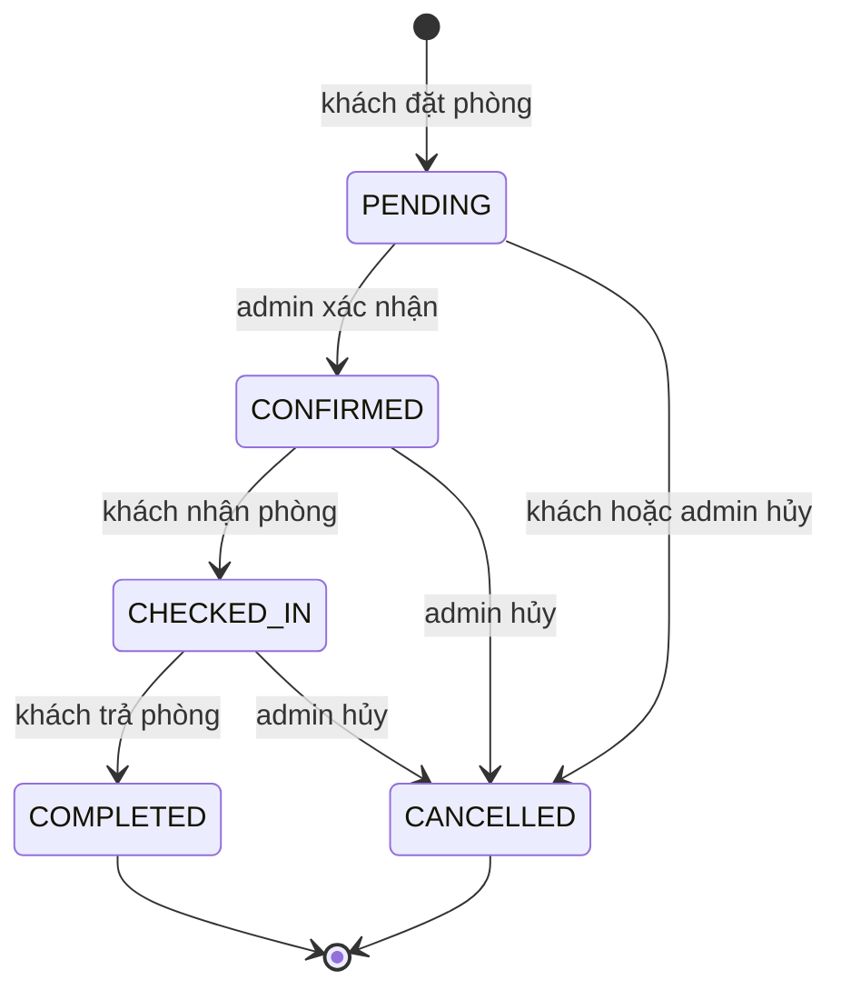

# QuickStay – Sơ đồ ERD và từ điển dữ liệu

Phiên bản 1.0 · 26/10/2026 · Nhóm 05. Khớp với các entity JPA trong `backend/src/main/java/com/quickstay`. Tên bảng và cột dùng `snake_case` (Hibernate tự chuyển từ camelCase).

## 1. Sơ đồ quan hệ



Quan hệ:

- Một khách sạn có nhiều loại phòng (`rooms.hotel_id` → `hotels.id`).
- Một người dùng có nhiều đơn đặt phòng (`bookings.user_id` → `users.id`).
- Một loại phòng có nhiều đơn đặt phòng (`bookings.room_id` → `rooms.id`).
- Hệ thống không lưu từng phòng vật lý. `rooms` là một **loại phòng** của khách sạn, có `quantity` phòng cùng loại. Đơn đặt phòng gắn với loại phòng, không gắn với số phòng cụ thể.

## 2. Từ điển dữ liệu

### 2.1. `users`

| Cột | Kiểu | Ràng buộc | Mô tả |
|---|---|---|---|
| id | BIGINT | PK, tự tăng | Mã người dùng |
| email | VARCHAR(255) | UNIQUE, NOT NULL | Email đăng nhập, luôn lưu chữ thường |
| password_hash | VARCHAR(255) | NOT NULL | Mật khẩu đã mã hóa BCrypt |
| full_name | VARCHAR(255) | | Họ và tên |
| phone | VARCHAR(255) | | Số điện thoại |
| role | VARCHAR(255) | | `CUSTOMER` hoặc `ADMIN` (mặc định `CUSTOMER`) |
| created_at | TIMESTAMP | | Thời điểm tạo tài khoản |

### 2.2. `hotels`

| Cột | Kiểu | Ràng buộc | Mô tả |
|---|---|---|---|
| id | BIGINT | PK, tự tăng | Mã khách sạn |
| name | VARCHAR(255) | NOT NULL | Tên khách sạn |
| city | VARCHAR(255) | NOT NULL | Thành phố |
| address | VARCHAR(255) | | Địa chỉ |
| description | VARCHAR(4000) | | Mô tả (có thể do AI sinh) |
| image_url | VARCHAR(1000) | | Đường dẫn ảnh đại diện |
| amenities | VARCHAR(1000) | | Tiện nghi, ví dụ `Hồ bơi, Wifi miễn phí` |

### 2.3. `rooms`

| Cột | Kiểu | Ràng buộc | Mô tả |
|---|---|---|---|
| id | BIGINT | PK, tự tăng | Mã loại phòng |
| hotel_id | BIGINT | FK → `hotels.id`, NOT NULL | Khách sạn sở hữu |
| room_type | VARCHAR(255) | NOT NULL | Tên loại phòng: Standard, Deluxe, Family Suite... |
| price_per_night | DECIMAL(19,2) | NOT NULL, ≥ 0 | Giá một đêm (VND) |
| capacity | INT | ≥ 1 | Số khách tối đa mỗi phòng |
| quantity | INT | ≥ 1 | Số phòng cùng loại hiện có |
| description | VARCHAR(2000) | | Mô tả loại phòng |

### 2.4. `bookings`

| Cột | Kiểu | Ràng buộc | Mô tả |
|---|---|---|---|
| id | BIGINT | PK, tự tăng | Mã đơn đặt phòng |
| user_id | BIGINT | FK → `users.id`, NOT NULL | Khách đặt |
| room_id | BIGINT | FK → `rooms.id`, NOT NULL | Loại phòng được đặt |
| check_in | DATE | | Ngày nhận phòng |
| check_out | DATE | | Ngày trả phòng (không tính là đêm ở) |
| guests | INT | ≥ 1, ≤ `rooms.capacity` | Số khách |
| guest_name | VARCHAR(255) | | Họ tên người nhận phòng |
| guest_phone | VARCHAR(255) | | Số điện thoại liên hệ |
| note | VARCHAR(1000) | | Ghi chú |
| total_price | DECIMAL(19,2) | | `price_per_night` × số đêm, tính khi tạo đơn |
| status | VARCHAR(255) | | Xem mục 3 |
| created_at | TIMESTAMP | | Thời điểm tạo đơn |

## 3. Trạng thái đơn đặt phòng



Khách chỉ được tự hủy khi đơn còn `PENDING`. Mọi chuyển trạng thái khác do admin thực hiện. Hai trạng thái cuối `COMPLETED` và `CANCELLED` không đi tiếp được.

## 4. Quy tắc kiểm tra phòng trống

Với loại phòng `R` và khoảng ngày `[check_in, check_out)`:

```
đã_đặt  = số đơn của R có status ≠ CANCELLED và b.check_in < check_out và b.check_out > check_in
còn_lại = R.quantity − đã_đặt
```

Đặt được khi `còn_lại ≥ 1`. Điều kiện chồng lấn dùng bất đẳng thức chặt nên hai kỳ nghỉ liền nhau (ngày trả phòng của đơn trước trùng ngày nhận phòng của đơn sau) không xung đột.

Để không đặt trùng khi nhiều người đặt cùng lúc, thao tác đặt phòng chạy trong một transaction và khóa bản ghi `rooms` bằng `SELECT ... FOR UPDATE` (`PESSIMISTIC_WRITE`) trước khi đếm.

## 5. Ràng buộc xóa dữ liệu

- Xóa khách sạn: xóa luôn các loại phòng của nó. Bị từ chối (HTTP 409) nếu bất kỳ loại phòng nào đã có đơn đặt phòng.
- Xóa loại phòng: bị từ chối (HTTP 409) nếu đã có đơn đặt phòng.
- Không có thao tác xóa người dùng hoặc đơn đặt phòng. Đơn được hủy bằng cách đổi trạng thái sang `CANCELLED`.

## 6. Ghi chú và đề xuất

- Hiện chỉ có chỉ mục tự sinh cho khóa chính, khóa ngoại và `users.email`. Khi dữ liệu lớn, nên thêm chỉ mục `bookings (room_id, check_in, check_out)` cho truy vấn đếm đơn chồng lấn và `hotels (city)` cho tìm kiếm.
- Lược đồ do Hibernate tạo (`ddl-auto=update`). Khi triển khai thật nên chuyển sang công cụ migration (Flyway hoặc Liquibase).
- `rooms.quantity` có thể bị admin sửa nhỏ hơn số đơn đang có. Hệ thống không chặn trường hợp này, các đơn cũ vẫn giữ nguyên.
